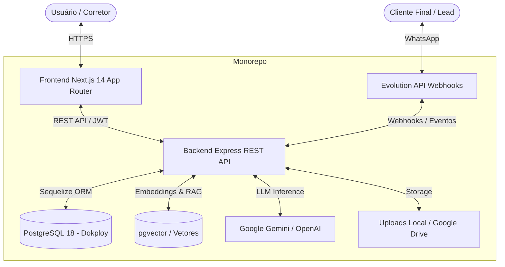
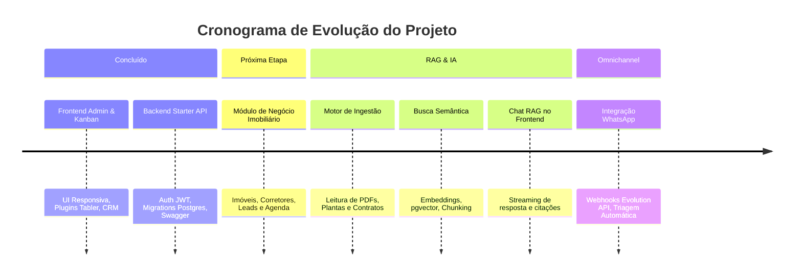

# 🏢 Plataforma Imobiliária Inteligente com RAG & CRM

> Ecossistema full-stack imobiliário de alta performance que une um **Painel Administrativo / CRM moderno** (Next.js 14) a uma **API REST modular** (Node.js/Express) preparada para **RAG (Retrieval-Augmented Generation)**, busca semântica em documentos de imóveis e atendimento inteligente multicanal.

---

## 📑 Sumário

- [Visão Geral](#-visão-geral)
- [Arquitetura do Monorepo](#-arquitetura-do-monorepo)
- [Tecnologias Utilizadas](#-tecnologias-utilizadas)
- [Status Atual do Projeto (O Que Já Temos)](#-status-atual-do-projeto-o-que-já-temos)
- [Roadmap & Próximas Etapas](#-roadmap--próximas-etapas)
- [Guia de Instalação e Execução Local](#-guia-de-instalação-e-execução-local)
- [Guia de Deploy & Mapeamento de Pastas](#-guia-de-deploy--mapeamento-de-pastas)
- [Segurança & Variáveis de Ambiente](#-segurança--variáveis-de-ambiente)

---

## 🎯 Visão Geral

O projeto foi projetado para atender imobiliárias e corretores de alto padrão com duas frentes principais:
1. **Frontend Administrativo e CRM**: Gestão ágil de leads com Kanban reordenável, vitrine de imóveis, performance de corretores, mapas interativos e suíte de componentes baseada no ecossistema Tabler.
2. **Backend & RAG Engine**: API escalável com autenticação segura (JWT com Blacklist), controle de acesso RBAC, armazenamento de arquivos e uma esteira de ingestão documental para alimentar modelos de linguagem (LLMs) capazes de responder dúvidas sobre contratos, plantas e fichas técnicas de empreendimentos imobiliários.

---

## 🏗 Arquitetura do Monorepo

O repositório é organizado no formato **monorepo desacoplado**, facilitando tanto o desenvolvimento unificado quanto o deploy independente dos serviços em ambientes como **Dokploy**, **Vercel** ou **Docker Containers**:

```
crud-rag-system/
├── frontend/                     # Aplicação Web (Next.js 14 App Router)
│   ├── src/
│   │   ├── app/                  # Páginas e Rotas (dashboard, crm, imoveis, etc.)
│   │   ├── components/           # Componentes UI (Sidebar, Header, Kanban, Charts)
│   │   └── types/                # Definições TypeScript
│   ├── public/                   # Assets estáticos e scripts de plugins
│   ├── .env.example              # Exemplo de configuração do frontend
│   └── package.json
│
├── backend/                      # API REST & Motor RAG (Node.js + Express)
│   ├── src/
│   │   ├── config/               # Conexão com PostgreSQL (Sequelize) e configurações
│   │   ├── controllers/          # Lógica de controle (Auth, Users, Plans, Uploads)
│   │   ├── models/               # Modelos Sequelize (User, Plan, TokenBlocklist)
│   │   ├── routes/               # Rotas da API v1 documentadas com Swagger
│   │   ├── middlewares/          # Autenticação JWT, RBAC, Validações e Rate Limit
│   │   └── services/             # Serviços auxiliares e integração de storage
│   ├── database/migrations/      # Migrações versionadas do banco de dados
│   ├── uploads/                  # Armazenamento local de arquivos e avatares
│   ├── .env.example              # Exemplo de configuração do backend
│   └── package.json
│
├── .agents/                      # Skills e diretrizes de desenvolvimento com IA
│   └── skills/
│       ├── realestate-admin-frontend/ # Especialista em UI/UX e Next.js
│       └── realestate-rag-backend/    # Especialista em RAG e backend seguro
│
├── .gitignore                    # Regras estritas de exclusão de artefatos e segredos
└── README.md                     # Documentação central do ecossistema
```



---

## 🛠 Tecnologias Utilizadas

### Frontend
- **Framework**: Next.js 14+ (App Router) & React 18
- **Linguagem**: TypeScript com tipagem estrita
- **Estilização**: Tailwind CSS (design minimalista e autêntico)
- **Componentes & Gráficos**: ApexCharts, DataTables, SortableJS, Tabler UI Plugins
- **Ícones**: Lucide Icons & Tabler Icons
- **Estado & Interatividade**: Drag-and-drop avançado com reordenação arbitrária em colunas Kanban

### Backend
- **Runtime**: Node.js 18+ & Express.js
- **Banco de Dados**: PostgreSQL 18 gerenciado via **Dokploy**
- **ORM & Migrations**: Sequelize & Sequelize CLI
- **Autenticação**: JWT (Access Token + Refresh Token) com verificação em tempo real via tabela de `TokenBlocklist`
- **Controle de Acesso**: RBAC (`admin`, `agent`, `client`)
- **Documentação de API**: Swagger UI / OpenAPI 3.0 disponível em `/api-docs/`
- **Armazenamento de Arquivos**: Multer com storage local permanente e suporte a integração com Google Drive

---

## 🚀 Status Atual do Projeto (O Que Já Temos)

### 1. Frontend Completo & Responsivo
- [x] **Layout Fluido & Adaptativo**: Header fixo com busca rápida e trigger móvel para abertura de menu lateral.
- [x] **Drawer Mobile Moderno**: Efeito deslizante suave (`slide-in` com curva de aceleração cúbica) com fundo desfocado (`backdrop-blur`).
- [x] **Sidebar Inteligente**: Suporte a colapso e expansão em desktop com ícone do logo interativo e botão retrátil que não quebra em nenhuma resolução.
- [x] **CRM Kanban com Drag-and-Drop & Reordenação Arbitrária**: Permite mover leads entre fases (Novos Leads, Contato Inicial, Visita Agendada, Negociação, Fechado) escolhendo a posição exata (topo, meio ou rodapé da coluna).
- [x] **Suíte de Plugins Integrada**: Dropzone para upload de fotos de imóveis, seletor de cores (colorpicker), calendário interativo (datepicker), tabelas com paginação e busca, e mapas vetoriais.
- [x] **Dashboard Analítico**: Métricas principais (VGV, Leads Ativos, Visitas da Semana, Taxa de Conversão) com gráficos interativos ApexCharts.

### 2. Backend Starter API em Produção Local
- [x] **Conexão PostgreSQL Testada**: Conectado ao banco Dokploy na porta `5437` com SSL configurável.
- [x] **Migrações Executadas**: Tabelas `users`, `plans` e `token_blocklist` criadas e operacionais.
- [x] **Autenticação Segura & Token Blocklist**: Rotas de `/auth/register`, `/auth/login`, `/auth/refresh` e `/auth/logout` com invalidação imediata de tokens revogados.
- [x] **Campos de Login Social**: Suporte nativo a provedores externos (Google/Firebase) na tabela de usuários.
- [x] **Upload de Arquivos & Avatar**: Rota `/uploads` com salvamento automático do endereço da imagem no perfil do usuário (`avatar_url`).
- [x] **Documentação Swagger UI Ativa**: Catálogo interativo de endpoints em `http://127.0.0.1:4000/api-docs/`.

---

## 🗺 Roadmap & Próximas Etapas



### Etapa 1: Módulo de Negócio Imobiliário (CRUD Imóveis & Leads)
- [ ] Criar migrações e modelos para:
  - `properties`: código, título, descrição, tipo, preço, metragem, quartos, endereço, status, fotos.
  - `leads`: nome, telefone, email, valor pretendido, estágio do funil, corretor responsável.
  - `schedules`: visitas presenciais e reuniões agendadas.
- [ ] Conectar os componentes do frontend às rotas REST do backend.

### Etapa 2: Motor RAG (Retrieval-Augmented Generation)
- [ ] Pipeline de ingestão documental para leitura de arquivos PDF (`pdf-parse`), planilhas (`xlsx`) e documentos Word.
- [ ] Divisor semântico de texto (*text chunker*) com preservação de metadados do imóvel.
- [ ] Geração de vetores (*embeddings*) via Gemini ou OpenAI.
- [ ] Armazenamento vetorial e consultas por similaridade de cosseno.

### Etapa 3: Interface de Chat RAG no Frontend
- [ ] Tela de chat interativa para corretores e clientes consultarem a base de conhecimento imobiliária.
- [ ] Streaming de respostas em tempo real com indicador de digitação.
- [ ] Exibição das fontes documentais (fichas técnicas, números de páginas, cláusulas contratuais citadas).

### Etapa 4: Integração WhatsApp (Evolution API)
- [ ] Configuração de webhook para escuta de mensagens do WhatsApp.
- [ ] Envio das mensagens para a fila de processamento (Redis + BullMQ).
- [ ] Resposta autônoma do agente RAG com transbordo inteligente para o corretor humano.

---

## 💻 Guia de Instalação e Execução Local

### Pré-requisitos
- **Node.js** v18 ou superior
- **npm** ou **yarn**
- **Git**
- Acesso à instância **PostgreSQL**

---

### 1. Clonar o Repositório
```bash
git clone https://github.com/Davisvasconcellos/crud-rag-system.git
cd crud-rag-system
```

---

### 2. Configurar e Executar o Backend
```bash
# Entrar na pasta do backend
cd backend

# Instalar as dependências
npm install

# Copiar o arquivo de variáveis de ambiente
cp .env.example .env
# Edite o arquivo .env com as credenciais do seu banco de dados PostgreSQL

# Executar as migrações do banco de dados
npx sequelize-cli db:migrate

# Iniciar o servidor em modo de desenvolvimento
npm run dev
```
> O backend estará rodando em `http://localhost:4000`. Acesse a documentação interativa em `http://127.0.0.1:4000/api-docs/`.

---

### 3. Configurar e Executar o Frontend
```bash
# Em outro terminal, na raiz do projeto:
cd frontend

# Instalar as dependências
npm install

# Copiar o arquivo de variáveis de ambiente
cp .env.example .env.local

# Iniciar o Next.js em modo de desenvolvimento
npm run dev
```
> O frontend estará rodando em `http://localhost:3000` (ou `http://localhost:3001` caso a porta 3000 esteja ocupada).

---

## 🚢 Guia de Deploy & Mapeamento de Pastas

Como o projeto é estruturado em monorepo, cada aplicação pode ser implantada de forma isolada mapeando a pasta raiz correspondente no painel do seu provedor de nuvem (por exemplo, **Dokploy**, **Coolify**, **Vercel** ou **Render**):

### 1. Deploy do Backend (Dokploy / VPS / Docker)
- **Repositório Git**: `https://github.com/Davisvasconcellos/crud-rag-system.git`
- **Branch**: `main`
- **Root Directory**: `backend`
- **Build Command**: `npm install`
- **Start Command**: `npm start` (ou `npm run dev`)
- **Porta**: `4000`
- **Variáveis de Ambiente**: Preencher com os valores do `backend/.env.example` apontando para o PostgreSQL e informando o segredo JWT.

### 2. Deploy do Frontend (Vercel / Dokploy)
- **Repositório Git**: `https://github.com/Davisvasconcellos/crud-rag-system.git`
- **Branch**: `main`
- **Root Directory**: `frontend`
- **Framework Preset**: `Next.js`
- **Build Command**: `npm run build`
- **Output Directory**: `.next`
- **Variáveis de Ambiente**:
  - `NEXT_PUBLIC_API_URL`: URL pública da API backend (ex: `https://api.seudominio.com.br/api/v1`)

---

## 🔐 Segurança & Variáveis de Ambiente

> [!CAUTION]
> **Nunca comite arquivos `.env` ou credenciais de banco de dados no Git.**

- Todos os arquivos com segredos locais estão declarados no [`.gitignore`](file:///c:/Users/davis.vasconcellos/OneDrive%20-%20MSF/Documentos/DAVIS/RAG/.gitignore).
- Utilize sempre os arquivos de template:
  - [`backend/.env.example`](file:///c:/Users/davis.vasconcellos/OneDrive%20-%20MSF/Documentos/DAVIS/RAG/backend/.env.example)
  - [`frontend/.env.example`](file:///c:/Users/davis.vasconcellos/OneDrive%20-%20MSF/Documentos/DAVIS/RAG/frontend/.env.example)
- O backend conta com **Rate Limiting** para prevenção de ataques de força bruta e **Token Blocklist** para invalidação instantânea de tokens revogados.

---

## 👥 Autores & Contribuição

Desenvolvido por **Davis Vasconcellos** & equipe.
Para dúvidas, abertura de PRs ou sugestões arquiteturais, consulte as diretrizes contidas nas skills em [`.agents/skills/`](file:///c:/Users/davis.vasconcellos/OneDrive%20-%20MSF/Documentos/DAVIS/RAG/.agents/skills/).
